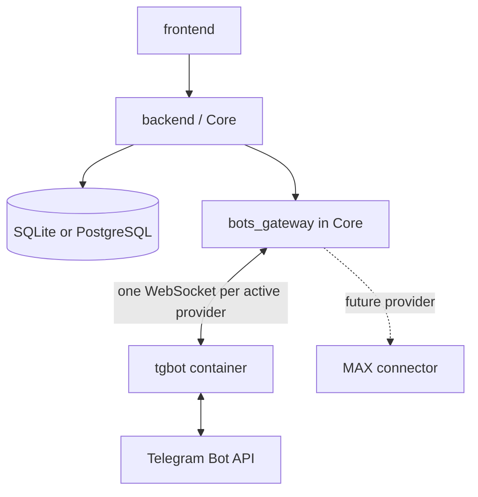

# Messenger Gateway (experimental, branch test)

## Architecture

Core owns the database, authorization, school assignments, dialogs, message history,
SSE, Web Push and the permanent media archive. `backend/app/bots_gateway/` is a
module of the existing FastAPI backend, not a separate service. The first connector
lives in `connectors/telegram/`; `connectors/common/` owns the reusable transport and
persistent event spool. `connectors/max/` reserves the next provider, but does not
pretend to implement MAX or start a MAX container.



The Telegram connector handles getUpdates, API calls and provider files. It neither
imports Core nor receives DB credentials or mounts app_data. The existing Telegram
business handlers and aiogram types remain in Core via an RPC session facade to
preserve commands, teacher menus, linking, group topics, copying and media. Core
does not use a real Telegram token in connector mode. There is no direct connector
access to the database or SSE. This transitional compatibility layer can be replaced
with fully provider-neutral business events later.

## 1. Same VPS (recommended first test)

Use an isolated test VPS or isolated database, domain and Telegram bot token.
Do not run two pollers with the same token. Take a full backup and save the
existing .env before switching an installation. Do not use a production volume
to test a different version of the schema.

From the checkout as the app user:

```bash
git fetch origin
git switch test
git pull --ff-only origin test
docker compose stop backend
cp -p .env .env.before-connectors
openssl rand -hex 32
nano .env
```

The stop command applies to an existing installation only. Generate a unique
secret with openssl; copy it into the .env, not the repository or logs.
Set or change these lines (preserve every other existing setting):

```dotenv
COMPOSE_FILE=docker-compose.yml:compose.connectors.yml
COMPOSE_PROFILES=bots
TELEGRAM_BOT_ENABLED=true
BOTS_GATEWAY_TELEGRAM_SECRET=
BOTS_GATEWAY_URL=http://backend:8000
```

Keep the real TELEGRAM_BOT_TOKEN in .env; the Compose override clears it from the
Core environment and passes it only to tgbot. Use `COMPOSE_PROFILES=bots,telegram`
if the local Bot API runs on the same Compose project, `bots,postgres` if the
internal PostgreSQL service is used, or combine all necessary profiles.
Keep TELEGRAM_API_MODE, TELEGRAM_API_URL and TELEGRAM_CACHE_HOST_DIR unchanged
when migrating an existing poller. Do not call Telegram logOut merely to move
the polling process; that is needed when moving between different Bot API servers.

```bash
chmod 600 .env
docker compose config --quiet
docker compose up -d --build
docker compose ps
docker compose logs --tail=50 backend tgbot
```

Expect backend, frontend and tgbot. The Core health endpoint may report a degraded
Telegram component during reconnect; its DB and web UI still work. The tgbot
healthcheck requires both a successful provider poll and an authenticated
Gateway connection. A duplicate connector is rejected; the connector does not
start polling before its first successful Gateway connection.

Independent update/restart of Telegram:

```bash
docker compose up -d --build tgbot
docker compose logs --tail=50 tgbot
```

If the Bot API is local or remote, its cache is mounted only into tgbot; Core
receives files over HTTP. Existing NFS may still be required if tgbot and
the local Bot API live on different VPS. Co-locating them removes that
inter-VPS NFS dependency. The cloud Bot API still has its own file size limits.

## 2. Different VPS (optional)

Use the existing private WireGuard network, with ingress restricted to the
connector's peer address. Do not publish TCP 8000 or the internal Bot API to
the public internet. The public Caddy frontend denies /internal/bots/*.

On Core, stop the old poller or local tgbot before starting a replacement.
If moving a connector with pending inbound events, preserve its tgbot_state
volume (stop it and transfer the entire SQLite spool including any WAL files
or use a SQLite-consistent backup). Simply copying an active SQLite file is
not safe. The source and destination must never poll concurrently.

Core .env:
```dotenv
COMPOSE_FILE=docker-compose.yml:compose.connectors.yml:compose.gateway-remote.yml
COMPOSE_PROFILES=
BOTS_GATEWAY_BIND_IP=10.77.0.1
TELEGRAM_BOT_ENABLED=true
BOTS_GATEWAY_TELEGRAM_SECRET=
```

The bind IP above is an example; use the actual private WireGuard address.
Keep other necessary profiles, but remove bots when using a remote connector.
If a local tgbot container already exists, explicitly stop it before changing
the profile and retain its volume. The bind override exposes the existing Core
HTTP port only on that private IP; firewall restrictions are still mandatory.

```bash
docker compose --profile bots stop tgbot
docker compose up -d --build backend frontend
```

On the connector VPS install the documented Docker stack, check out the same
test revision and create a separate .env containing only:

```dotenv
TELEGRAM_BOT_TOKEN=
TELEGRAM_API_MODE=cloud
BOTS_GATEWAY_URL=http://10.77.0.1:8000
BOTS_GATEWAY_TELEGRAM_SECRET=
```

Use the real token and the same gateway secret as Core. If using a local
Telegram Bot API, set TELEGRAM_API_MODE=local, TELEGRAM_API_URL to the private
reachable endpoint, and TELEGRAM_CACHE_HOST_DIR to the accessible read-only
cache root. Do not copy the Core DB password or admin password to the bot server.

```bash
chmod 600 .env
docker compose -f compose.connector-remote.yml config --quiet
docker compose -f compose.connector-remote.yml up -d --build
docker compose -f compose.connector-remote.yml ps
```

Use this same command with -f for subsequent remote-only connector updates.

## 3. Protocol v1

The connector initiates a single authenticated WebSocket at
`/internal/bots/ws/{platform}`. Bearer secrets are specific to registered
platforms. The Core sends hello with the protocol version. The shared client
handles reconnect with backoff and transport heartbeat. The gateway rejects
duplicate live peers and bounds frame size, event queues and pending commands.

| Frame | Direction | Purpose |
| --- | --- | --- |
| hello | Core → connector | Protocol version |
| event | connector → Core | Provider event payload and stable event ID |
| ack | Core → connector | Event processing result, same ID |
| command | Core → connector | Operation, payload and correlation ID |
| result | connector → Core | Command result, same ID |
| ping / pong | either as supported | Optional application heartbeat |

Telegram operations currently use telegram.api (allowlisted method and fields)
and telegram.download. The envelope, authentication, reconnect, media and event
acknowledgements are shared by future providers. All provider-specific operations
are namespaced. A new provider implements an event handler in Core and a transport
worker; the business models and conversations remain in Core.

Large media never travels as base64 or as a WebSocket frame. Core issues
single-use opaque tickets at /internal/bots/media/{platform}/{ticket} with
provider-specific authorization. GET streams an existing Core file and PUT
streams to a Core-selected temporary path, bounded to 1 GiB. No client-supplied
filesystem paths are accepted by the Core media endpoint. A timeout revokes the
ticket. The provider may impose smaller limits.

## 4. Reliability and current limitations

* tgbot stores raw inbound updates and provider offset in a persistent local
  SQLite spool before advancing getUpdates. It removes an event only after the
  Core acknowledgement. Core stores completed event receipts in its normal
  database, and existing message IDs continue to protect against duplicate
  message rows. This is at-least-once transport, not exactly-once side effects.
* Web conversation messages enqueue a durable outbox job atomically with the
  message. While the connector is disconnected jobs remain queued; on reconnect
  the worker sends via the same existing delivery logic. SSE and Push do not
  wait for an external API call in connector mode. Other web features retain
  their original behavior.
* A crash during an already-started send is marked unknown rather than
  automatically repeating a potentially successful send. Partial external
  deliveries are recorded by the existing metadata logic. The current outbox
  covers web conversation sends, not every inbound forwarding side effect,
  deletion, or Telegram UI operation. A crash between an inbound side effect
  and receipt can repeat a command/callback; an already-persisted message may
  require reconciliation for a failed external forwarding. There is no claim
  of exactly-once delivery or a complete all-provider retry system.
* The connector spool is capped at 10,000 events per bot. At capacity polling
  pauses; Telegram's provider retention is finite. Monitor health and disk space.
  Do not delete tgbot_state or use down -v. Core receipts and jobs are included in
  the main DB backup; the connector spool is separate transport state.
* Core currently runs a single Uvicorn worker. Multiple Core processes would
  require a shared peer registry, coordination and distributed SSE/outbox claims.
* The old embedded transport remains available during testing. Do not revert
  with queued jobs without reconciling/draining them first. To switch back,
  stop tgbot, restore the saved .env (retaining legitimate later changes),
  remove connector-only profiles/overrides, then recreate backend. Never run
  both modes concurrently.
* MAX is only a directory and integration scaffold; no fake running service.
  Implement and test real MAX authentication, API events, media and delivery
  using the common connector before enabling it.

## 5. Acceptance checks

On an isolated test deployment, test account linking, /start, /menu, buttons,
group topic binding, text both directions, teacher menu updates, documents,
photos, audio, video, media archive and Web Push/SSE. Stop tgbot and send a web
message: the web response and SSE must complete while external delivery is queued.
Restart tgbot; verify queued messages and external IDs. Stop Core temporarily
while tgbot is polling; verify the local spool retains events and sends them
after reconnection. Repeat with a private remote connector, and confirm public
HTTP /internal/bots/* is denied. Verify backup/restore on the test DB and
review unknown/failed delivery metadata before production rollout.
